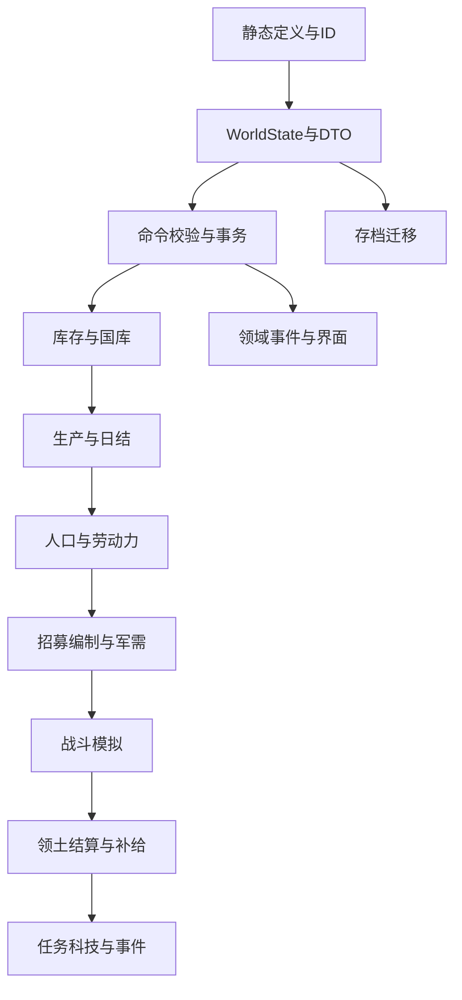

# Frontier Guardian 游戏设计与开发方案

版本：0.1　日期：2026年11月9日　用途：设计基线、工程拆分、测试验收。

本文定义一款以领主管理为中心的单人战争经营游戏。开发先完成可连续游玩的经济与战争闭环，再扩展经营复杂度。本文所有产量、价格、时间、属性、容量、规模和工期均为待平衡参数或计划估算，不代表已验证结果。规则中的 ID、字段类型和结算顺序属于实现契约。

## 1 产品定位与范围

### 1.1 最终方向

Windows PC、单机、2D 等距像素风。玩家是固定于管理层的领主或统帅，没有可移动主角。玩家在城镇地图摆放建筑、分配劳动力，在区域地图派遣军团，在战场下达军团命令；士兵自动移动、寻敌和攻击。定位为中小规模领地经营加实时战术，核心体验是“生产与税收支撑军队，军队保护生产并夺取新的资源”。背景采用架空边境：旧王国失去边地控制，领主以有限人口与粮草重建防线。

目标玩家偏好可暂停决策、能解释的生产链与战损。首次场景目标时长45至90分钟；完整战役后续再确定。失败必须有预警、账单和恢复途径，避免缺粮后立即无法挽回。

### 1.2 核心循环

短循环：查看短缺 → 调岗或调整配方 → 生产入库 → 消费与日结 → 查看预测。

中循环：扩建住房与粮食链 → 招募训练 → 装载军粮 → 防守或出征 → 处理伤亡并补员。

长循环：侦察邻区 → 击败据点 → 驻军接管 → 修复补给道路 → 获得资源或贸易权限 → 解锁科技和更强兵种。

### 1.3 范围矩阵

|系统|MVP 可玩版本|后续扩展|
|---|---|---|
|地图|手工主城1张，边境林地与敌方据点，共3区|6至10区、多城管理、地区特性|
|经营|总人口、可就业人口、调岗、住房、粮食加工、税与账单|人口分层、牧场、完整装备链、复杂市场|
|军队|盾步兵、弓手、长枪兵；最多3军团|骑兵、攻城、医护；最多8军团|
|战斗|最多双方合计120实体；移动、进攻、防守、撤退|300实体目标、复杂阵型、野战事件|
|城防|固定城墙、城门、2类塔位|自由城墙、攻城器械、围困|
|领土|邻区侦察、一次据点夺取、资源收益|多城驻军、补给网络、占领稳定度|
|系统|暂停与倍速、事件、6任务、3科技、存档|科技树、贸易事件、长战役|

不纳入首版：联网、多人、英雄走动与技能、开放世界无缝地图、海战、外交模拟、程序生成世界、逐居民实体生活模拟、真实流体物流和可破坏地形。人口为数值账本；运输用货物记录和区域路线表示。MVP 据点攻占是城门加守军的简化攻城，完整器械攻城延期。

### 1.4 MVP 完成定义

从新档出发，建造粮食链与兵营，稳定维持30名居民和12名士兵10天；抵御一次袭击，侦察并攻占一个相邻据点，完成任务；全过程可保存恢复，资源、人口和军队守恒，无需调试菜单。主城失守进入失败界面，可读取档案；单支军团覆灭不结束游戏。

## 2 世界 区域 城镇

世界是区域邻接图，区域包含城镇、资源点、战场入口与道路边。区域战略位置不等于城镇地块坐标。城镇地图建议64×64逻辑格，战场96×96格，地块呈64×32像素菱形。世界界面显示节点与连线，进入区域后载入其城镇或战场场景。

|区域|初始状态|进入与控制条件|收益与威胁|
|---|---|---|---|
|r_home 边境镇|己方控制|初始开放|主城、基础农田，预计第5日袭击|
|r_woods 北部林地|已知未侦察|军团侦察1日，耗2军粮|清除6名敌军后控制伐木资源点|
|r_fort 旧堡|未知|林地完成侦察后揭示；与己方控制区相邻|击破城门和守军，占领后每日5金币|

状态分开保存：visibility 为 hidden/known/scouted；owner 为 faction ID 或 null；access 为 blocked/open。侦察不自动获得所有权。出征要求目标已知、路线可达、有可行动军团；攻占要求守军失败、关键目标控制且有至少1名未溃退士兵存活。战略行军按边消耗时间，例如每边1日；抵达只触发遭遇，不瞬间夺取。

据点胜利后立即归属玩家，收益从次日日结开始。MVP 一次性固定占领事件；后续增加0至100稳定度，低于30无税收，驻军和修复每天增加5，掠夺减少20。占领地图复用模板，不为每区制作独立建筑全套。

主城远景显示建造格和功能图标；领主头像驻于顶部管理栏。镜头拖动、滚轮缩放、框选军团、右键命令；空格暂停，1/2/3切换1/2/4倍速。战斗最高2倍速。打开设置和存档界面暂停，普通信息面板不暂停，必须显示当前速度。

## 3 建筑 生产 人口

### 3.1 建筑目录

费用记为木/石/金，生产单位为每日满岗产量。未列成本的输入为0；金币来自国库，其余来自本城库存。所有数据待平衡。

|建筑 ID|阶段|占格|1级费用|用工|1级功能|
|---|---|---|---|---|---|
|b_hall 领主厅|MVP 初始|4×4|初始|0|税收、建造管理、科技入口|
|b_house 住宅|MVP|2×2|20/0/10|0|人口容量+10|
|b_farm 农场|MVP|4×4|25/0/10|4|产谷物30|
|b_mill 磨坊|MVP|2×2|20/10/15|2|谷物20→面粉20|
|b_bakery 烘焙坊|MVP|2×2|20/10/15|2|面粉20→口粮30|
|b_granary 粮仓|MVP|3×3|30/10/10|0|食品容量+1000|
|b_store 仓库|MVP|3×3|30/0/10|0|材料容量+1000|
|b_lumber 伐木场|MVP|3×3|15/0/5|3|木材15|
|b_quarry 采石场|MVP|3×3|20/0/10|3|石材10|
|b_barracks 兵营|MVP|3×3|40/20/30|2|训练槽1，训练进度由岗位效率决定|
|b_market 市场|MVP 简版|3×3|20/10/20|1|定额采购与出售，次日到货|
|b_watch 箭塔|MVP|2×2|25/15/20|0|驻防武器，攻速1次/秒，伤害6|
|b_gate 城门|MVP 固定|3×1|固定预置|0|HP 1200，可修复|
|b_wall 城墙|MVP 固定|1×1|固定预置|0|HP 800，阻挡通行|
|b_ranch 牧场|扩展|4×4|40/0/30|3|谷物6→肉8；马匹另选配方|
|b_kitchen 肉食坊|扩展|2×2|25/10/20|2|肉8→口粮16|
|b_pack 军需所|扩展|3×3|30/15/25|2|口粮20→军粮18，耐储存|
|b_mine 铁矿|扩展|3×3|40/20/20|4|铁矿12|
|b_smith 铁匠铺|扩展|3×3|40/30/40|3|铁矿6+木材2→装备2|
|b_stable 马厩|扩展|3×3|50/20/50|2|骑兵训练|
|b_workshop 工坊|扩展|3×3|60/30/60|3|木材20+装备2→攻城器械1，耗3日|
|b_hospital 医馆|扩展|3×3|30/20/30|2|每日治疗4名伤兵|
|b_lab 学院|扩展|3×3|40/30/50|3|研究岗位与高级科技|
|b_depot 补给站|扩展|3×3|30/20/30|1|路线节点、前线军粮储备|

MVP 初始已有领主厅、3住宅、1农场、粮仓、仓库和固定城防；初始库存木120、石80、金币300、谷物60、口粮180。初始不存在磨坊与烘焙坊，教学引导优先建成；建筑须有通向领主厅的道路连接才能运作，MVP 道路免费，仅作连通判定。禁建于水面、边界、固定入口、其他建筑占地和资源禁占区。

### 3.2 等级 建造与效率

MVP 仅1级；后续开放2和3级。2级升级费用为1级费用×1.8、产能×1.5、岗位数+1；3级费用×3、产能×2.2、岗位数+2。仓库与住房升级分别按容量×1.5/2.2，不增加岗位。升级停产且原占地不变。

建造需空闲工人担任建筑工；默认最多2人，工作量为4工日。建造队列确认时一次扣除费用；取消返还未完成比例×已付款的80%，结果向下取整。重复点击使用命令 ID 防止重复扣费。拆除返还原材料25%，不得拆最后一座领主厅；库存超容时禁止拆仓并说明短缺容量。

效率 = clamp(在岗人数/需求人数, 0, 1) × 连接系数 × 科技系数 × 民众满意度系数。

连接系数取0或1；满意度系数 = 0.75 + 0.005×满意度（0至100），初始50时为1。生产不逐帧完成：每小时固定逻辑步处理一次，按当时效率累计配方进度。一个生产批次先检查全部输入与输出空间，整体执行，禁止只扣一部分输入。无输入、无空间、无人手、未连路都显示停产原因。

### 3.3 人口与劳动力守恒

居民总数 = 可就业居民 + 被抚养居民；初始30 = 24 + 6。可就业居民 = 在岗 + 建筑工 + 新兵训练中 + 空闲。士兵与军队伤兵不计入居民总数，但计入领地总人口。领地人口 = 居民 + 在役士兵 + 军队伤兵；招募将1名空闲可就业居民转成训练人员，毕业后从居民转入军队，不能凭空生成。

取消训练返回原居民池，阵亡从领地人口永久扣除；解散健康士兵返回可就业居民，装备不返还，伤兵先治疗。MVP 无自然出生死亡，每3天若住房余量≥2、满意度≥60、未来3天口粮充足，则移入2名可就业居民。人口变化只在日结执行，并检查容量。住房满不驱逐已有居民，但阻止移民。

优先岗位建议：粮食链 → 木石 → 训练 → 市场。界面提供锁定岗位与“释放1人”；兵营招募必须提示会影响的空闲人数，不自动夺走农民。

## 4 经济 粮草 库存与贸易

### 4.1 资源与计量

|资源|用途|存放|基础买价/卖价|
|---|---|---|---|
|谷物 grain|加工、牧场|食品库|2/1|
|面粉 flour|加工|食品库|3/1|
|口粮 food|居民、驻军、MVP行军|食品库|4/2|
|军粮 ration|扩展野外供给|食品库或军团背包|5/2|
|木材 wood|建造、装备|材料库|3/1|
|石材 stone|建造、城防|材料库|4/2|
|肉 meat|扩展食物链|食品库|4/2|
|铁矿 iron|扩展装备|材料库|5/2|
|装备 equipment|扩展训练升级|材料库|12/6|
|马匹 horse|扩展骑兵|材料库抽象容量|20/10|
|金币 gold|税收、军饷、交易|领地国库|不可交易|

库存基本单位为千分之一件的整数，金币存为最小单位整数，界面显示小数。公式中的实数结果先积累余数，再转整数入账。库存可用量 = 总量−预留量；建筑、市场、训练、运输均通过统一事务接口修改库存。

每单位资源占1容量，食品与材料独立计算。初始各有1000容量。满仓生产停转；运输到货无法容纳则保留在到货队列，不消失，也不可出售为无限临时仓。每城最多10笔待收货，满队列禁止新采购。MVP 不腐败；后续食品每日腐败0.5%，军粮0.1%，按品类总量执行并保留小数余数。

### 4.2 食物与军粮

居民每日消耗0.5口粮/人；士兵每日1口粮/人；骑兵额外消耗0.5谷物/骑兵作为饲料。驻军与居民从本城消费；出征从军团背包消费，不得再扣城内同一批食物。

MVP 直接使用口粮作为军粮，界面称“随军口粮”，底层仍为 food；扩展后统一迁移为 ration 并启用军需所。装载是从城镇库存到军团库存的转移事务，默认装载5日份，背包容量为每健康士兵8份。允许主动降低装载，但出征界面红色提示预计断粮日期。

居民和驻军共享缺粮时按需求同比例分配，不默认饿死平民保全军队。满足率 s = 实际分配/需求；居民满意度每日变化 −10×(1−s)，军队士气 −20×(1−s)。连续3日满足率<0.5 后，士兵每日逃亡2%向上取整，居民每日流失1人；恢复供给后计数归零。MVP 关闭居民饿死，保留离境。

粮食链验算：2农场满岗产谷60，2磨坊转40，2烘焙坊产口粮60；60居民耗30，20步兵耗20，净余10/日，另余谷20。需16名农业岗位，可就业48人时有足够余量。初始1条链产30、30居民耗15，可支持12士兵耗12，净余3；生产是否跟上应由玩家而非隐藏加成决定。

### 4.3 金币 军饷与税

每日税 = 居民数 × 0.8 × 税率系数 × 满意度系数；满意度系数 = clamp(满意度/60, 0.5, 1.2)。低/标准/高税系数0.7/1/1.3，对满意度日变化+1/0/−2。军饷见兵种表，建筑维护默认每座生产建筑1金币/日，住宅和仓库免维护。

日结先收税，再支付军饷，再支付建筑维护；金币不足时每支军团按应付军饷比例分配，未付部分进入该军团欠饷，不出现负金币。当天军饷支付率p使士气变化 −10×(1−p)；补缴历史欠饷不重复扣当天士气。生产建筑维护不足次日效率×0.8，不销毁建筑。UI显示现有金币、每日净额、欠饷和预计可维持天数。

例：居民30、满意度60、标准税，每日24金；12盾兵日饷6金，6座生产建筑维护6金，净余12金。招募费用是一次性费用，不能与日饷混淆。

### 4.4 市场与补给线

MVP 市场每天每类最多买20、卖20，固定买卖价，采购付款后次日送达，卖出立即扣货并入金。买价始终高于卖价；任务赠送物资同样入账，禁止无容量赠送。

扩展价格 = 基价 × clamp(1 + 0.5×(目标库存−本地供应)/max(目标库存,1), 0.7, 1.6)，卖价再乘0.5；每天更新一次，买卖不立即反复推动价格。商队订单锁价，途中中断不刷新价格。

MVP 补给为“从最近己方区域装载后自行携带”；林地或据点控制后可回城补给，暂无自动远程补给。扩展将己方道路、城镇、补给站构成图；路径存在且沿途未被封锁才可建立运输。每条线基础容量40单位/日，每边耗1日。出发时扣起点，货物存于 shipment；到达后加终点。断路使运输停在上一安全节点，路线恢复后继续，不退回已消耗物资、不复制货物。军团无粮先扣士气，不瞬间判败。

## 5 军队系统

### 5.1 兵种初值

战斗格距采用逻辑格，速度为格/秒。攻击为单次基础伤害。日饷单位为金币/人。

|兵种|类别与阶段|HP/甲/攻击|间隔/射程/速度|招募金/日饷/训练日|定位|
|---|---|---|---|---|---|
|u_shield 盾步兵|步兵 MVP|100/6/12|1.2/1/1.5|8/0.5/2|吸收伤害，远程减伤20%|
|u_spear 长枪兵|步兵 MVP|85/4/14|1.4/1.2/1.5|9/0.5/2|对骑兵伤害×1.5|
|u_archer 弓手|远程 MVP|60/1/10|1.5/6/1.5|10/0.6/2|后排，近身仍可攻击但伤害×0.5|
|u_cavalry 骑兵|骑兵 扩展|140/5/18|1.4/1/2.6|25/1.2/3|消耗1马匹和1装备，侧翼|
|u_ram 冲车|攻城 扩展|600/8/40|3/1/0.7|60/2/4|对城门×3，不能攻击士兵|
|u_medic 医护兵|辅助 扩展|55/1/0|2/3/1.5|18/0.8/3|每2秒治疗友军5HP，禁复活|

MVP 装备抽象为招募费用，兵种无独立物品栏；后续装备以批量档次0/1/2管理，每晋级一名消耗1装备，攻击和护甲各+10%/20%，不得叠乘两遍。医护和器械每实体按一个人口槽计，器械操作员不另作战斗实体，完整乘员模拟延期。

### 5.2 编制与招募

士兵 Soldier 是战斗实体；小队 Squad 为同兵种行政集合；军团 Army 为战略命令与补给单位。MVP 每小队上限10人、每军团3小队、领地最多3军团。UI显示人数、兵种、战备、士气、军粮天数。

招募需空闲居民、金币、训练槽与目标军团容量；扩展增加装备与马匹要求。下单扣费并锁定居民，训练逐小时按兵营效率推进；训练完成才成为士兵、开始领军饷。完成时军团已满则进入营地预备队，不消失。编组与拆组只在驻城和非战斗状态允许，调动携带各小队伤员并重新分摊背包粮食，超容余量退本城。

### 5.3 士气 满意度 伤亡

军团满意度代表长期待遇，0至100，初始70。每天向待遇目标值靠近最多2点；目标值 = clamp(50 + 20×供粮率 + 20×当日军饷支付率 − 10×连续出征天数/5,0,100)。当日即时士气初始取军团满意度；战斗中每损失10%初始兵力扣5，侧翼受击一次扣3（每10秒最多一次），击溃敌小队加3。

士气攻击系数 = 0.8 + 士气/250；低于25进入溃退，往己方出口跑且不能接受攻击命令；到安全点后退出战场。恢复到40需战后有粮驻扎至少1日，不能靠原地重复防守命令刷回士气。

HP归零从战场移除，结算时按固定 RNG 判定：基础40%转伤兵、60%阵亡；胜方医护可将伤兵概率提高到55%。撤退成功者保留伤兵；军团全灭且无己方控制战场时伤兵全部计损失。MVP 伤兵在驻城有足额食物时每3日恢复1人/军团，期间仍耗口粮与半额日饷；扩展医馆提高速度。补员不是恢复阵亡者：必须重新招募居民或调入预备队。战报明确战前人数、健康存活、伤兵、阵亡、逃亡和俘虏损失，不混成一个“死亡数”。

## 6 实时自动战斗与城防

### 6.1 模拟与指令

战斗采用固定20Hz逻辑步，渲染插值。玩家可暂停下令；命令在下一逻辑步生效。每步先收命令、更新状态与目标，再移动、生成攻击意图、统一应用伤害、处理溃退死亡、判断结束。同期攻击允许同归于尽。视觉投射物不独立判伤，伤害在预定命中时刻由逻辑事件执行。

|军团命令|含义|完成与限制|
|---|---|---|
|移动 Move|移动到目标格，途中仅近身自卫|到位转防守，不主动追出队形|
|进攻 AttackMove|前往目标格，沿途遭敌自动交战|追击半径8格，目标失效重新选敌|
|防守 Hold|以目标为中心保持阵地|追击不超4格；弓手保持射程|
|集火 Focus|优先指定单位或建筑|无法到达显示阻挡，最多尝试3秒后改攻附近威胁|
|撤退 Retreat|全军前往己方出口|到达者撤离；途中仍可受伤，不能传送|

军团命令落实为各小队目标和站位。MVP 仅横列和纵队两阵型；横列每排5格、纵队每排2格，盾兵优先前排，弓手后排。阵型为软约束，交战后允许破阵；战后无敌人3秒再集结。楔形、包围和复杂侧击延期。

### 6.2 AI 目标与伤害

状态机：Idle → Moving → Acquiring → Chasing → Attacking；可转 Routing、Dead。每0.25秒错峰重选目标，当前目标有效且未超过追击范围时保持，避免抖动。

评分 = 兵种优先分 + 受威胁分 − 距离×2 − 路径阻挡惩罚。医护优先可达的最低生命比例友军；冲车只选城门；盾兵选最近近战；弓手优先射程内低护甲单位。分数相等按稳定实体 ID 排序。目标过滤先做敌我、存活、区域、可攻击类型检查。

伤害 = max(1, 基础攻击 × 兵种克制 × 士气系数 × 装备系数 − 护甲) × 远程减伤系数，最后取整。MVP 命中率100%，无暴击、无随机闪避，以便先验证战术与数量平衡。远程有格网遮挡检测；墙后无视野不能射击，箭塔站高只允许越过己方低矮建筑，不允许穿敌城墙。弹药在MVP中无限，后续再引入远程补给。

### 6.3 寻路与避让

逻辑格网与画面投影分离。城墙和建筑为静态阻挡，城门状态变化时只更新相关格。MVP 使用 AStarGrid2D，每小队求一次主路径，士兵追随分配的邻近站位；使用局部格预留避免重叠。禁止斜穿两个相邻阻挡角；入口预留至少3格宽。单位间不互相作为永久障碍。

卡住1秒先换邻近站位，2秒重寻路，3秒向UI报告不可达；禁止跨墙传送。每逻辑步路径预算最多4次，其余排队；大军团分帧重算。地图全堵时返回失败路径，不无限循环。后续若拥堵成为主要瓶颈，再评估流场或导航网格，不同时维护两套权威寻路。

### 6.4 城防 攻城 胜负

塔必须已建成、HP>0、守军控制且未停用。塔内置抽象守备，不额外产生居民或士兵；不消耗小队人数。箭塔射程7格、HP500；重塔延期，射程5格、伤害16、间隔2秒。防守开始后禁止新建、拆除和即时修复，避免战中刷墙，战后修复按缺失HP每100消耗木2石1并耗0.1日。

MVP 敌方进攻路径指向城门，城门破坏后进入领主厅；领主厅HP1500，归零主城失败。攻占旧堡需城门归零且守军全部死亡或撤离，并保持据点中心5秒。城墙只承担阻挡与固定射击遮挡，MVP不开放登墙；完整攻城加入冲车、可破坏墙段与守军维修队，攀梯和高差作战延期。

野战胜利为敌军全部死亡/撤离且己方有可战单位；双方同时失去可战单位判平局，领土不变。撤退保存实际离场者。战斗最长10分钟，超时攻击方撤退。战报只结算一次，result_applied保护所有权、掉落与任务奖励。

MVP 同时只有一场战斗；战斗期间战略时钟冻结，建筑、税收、行军与其他事件停止推进，战斗逻辑正常推进。切回城镇只能查看，不改变经济。这样战斗时长不会造成隐形数日消耗；出征开始与日结承担军粮成本。后续若开放并行战争，必须重新设计统一时间倍率。

## 7 时钟 日结 事件 科技与存档

### 7.1 时间契约

战略1日为现实120秒，分24小时；固定1秒推进0.2游戏小时，暂停不累计离线时间。内部以整数战略 tick 计时，每日120 tick；战斗另存 battle_tick。使用累加器逐步追赶，帧卡顿不能跳过日结，也不能同一天结算两次。倍速改变积累速度，不改变结算公式。

每日边界执行：完成本小时生产 → 运输到货 → 按旧人口收税 → 食物分配 → 支付军饷和维护 → 士气与满意度 → 治疗和人口变化 → 任务和事件 → 更新路线/市场 → 生成账单 → 更新 last_settled_day → 发 day_settled。所有任务奖励在消费之后发放，从次日才影响税基。日结为不可中断事务，存档只在提交后捕获快照。

### 7.2 事件与任务

|内容 ID|触发|玩家行动与结果|
|---|---|---|
|q_food|新档|建成磨坊与烘焙坊并产30口粮，奖励20木|
|q_stock|完成q_food|保持3日供粮预测，奖励30金|
|q_army|完成q_stock|训练6盾兵与4弓手，奖励20口粮|
|q_defend|第5日袭击|守住领主厅，奖励50金|
|q_scout|完成q_defend|侦察林地，揭示旧堡|
|q_capture|完成q_scout|攻占旧堡，场景胜利|

袭击前2日预警，若教学未完成仍按时到达，但第一次敌人仅6近战+2弓手。事件参数用数据配置，触发后存 fired 标记。扩展事件：歉收产量−20%持续3日、难民入境、商人粮价优惠；选择结果在事务中统一扣费发奖。不能以反复读界面刷新 RNG。任务仅监听已提交领域事件；领取奖励使用 claimed 布尔值和 reward transaction ID 双重保护。

MVP 三科技：农具（金60、2日、农场+10%）、粮仓管理（金40、1日、食品容量+20%）、操练（金80、3日、新兵HP+10%）。操练在训练完成时记录科技属性版本，既有士兵不自动叠加；扩展改为统一重算时需迁移。MVP研究由领主厅提供一个槽位，不要求学院。科技依赖为农具→粮仓管理，操练独立；不可并行，无循环依赖。

### 7.3 存档策略

手动3槽、自动轮换3槽；每日、战斗前、战斗结果提交后自动保存。MVP不提供战中手动保存；battle_states字段保留为扩展接口，战前快照可恢复到部署阶段。扩展战中恢复需同时保存单位HP与位置、冷却、命令、目标、延迟命中事件、RNG状态、战斗计时和结果标记；缺任一项不得宣称支持战中一致恢复。

保存流程：冻结命令入口 → 从权威数据生成 DTO → 校验 → 写同目录临时文件 → 读取校验 → 替换正式档并保留上一备份。Windows 文件替换失败必须保留旧档并提示重试。读取流程：解析 → 版本迁移 → Schema与交叉引用校验 → 临时构建世界 → 成功后替换当前世界。坏档不能清空正在玩的世界。默认不执行存档中的脚本或场景路径。

## 8 Godot 技术架构

### 8.1 版本与项目布局

建议选择支持 TileMapLayer 的 Godot 4.x 稳定小版本，在项目创建时锁定完整版本和导出模板；本文件不指定“最新版本”。代码使用带类型 GDScript，渲染先用 Compatibility，目标1080p。像素资源用最近邻采样，逻辑摄像机缩放优先整数倍；UI使用独立缩放适配，不跟随世界像素缩放。

静态配置放 res://data/definitions/，动态状态放 model/，计算放 systems/，玩家指令放 commands/，界面放 ui/，可视场景放 scenes/，测试放 tests/。资源不携带动态HP或库存。画面节点销毁时权威军队和城镇数据仍存在。

```text
Main
 ├─ WorldRoot
 │   ├─ RegionMapView
 │   ├─ TownView
 │   │   ├─ GroundLayer  TileMapLayer
 │   │   ├─ RoadLayer    TileMapLayer
 │   │   ├─ BuildingViews  Node2D YSort
 │   │   └─ Camera2D
 │   └─ BattleView
 │       ├─ TerrainLayers
 │       ├─ UnitViews  Node2D YSort
 │       ├─ ProjectileViews
 │       └─ Camera2D
 └─ UILayer  CanvasLayer
     ├─ ResourceBar
     ├─ TimeControls
     ├─ SelectionPanel
     ├─ RegionPanel
     ├─ ArmyPanel
     └─ ModalHost
```

### 8.2 Autoload 与模块职责

|模块|职责|禁止承担|
|---|---|---|
|DefinitionDB|载入和校验Resource，按def_id查配置|保存玩家库存|
|GameSession|唯一WorldState、模式切换、CommandRouter、时钟入口|直接写UI控件|
|SaveService|DTO、迁移、文件读写、备份|自行推进游戏|
|EventBus|转发已提交领域事件|当作状态数据库或异步结算器|
|SettingsService|音量、分辨率、按键|战役进度|

EconomySystem、PopulationSystem、ArmySystem、RegionSystem、TaskSystem、ResearchSystem由GameSession持有，均接收明确状态与参数；BattleController只在战斗模式创建。不要每个系统都做Autoload。InventoryService是唯一库存写入口；TreasuryService是金币写入口；各系统通过事务请求它们。

### 8.3 依赖与事件流



图表示推荐构建顺序，运行时避免隐式递归调用。日结由协调器显式依次调用各系统，不能让 day_changed 的任意监听顺序决定扣粮先后。

建造事件流：UI发 BuildCommand(command_id,town_id,def_id,cell) → 校验地块、道路和成本 → 原子扣费并创建BuildingState → 提交 World revision → 发 building_queued → UI刷新。失败返回错误码与缺少数量，不发成功事件。

战斗事件流：RegionSystem生成BattleContext → 快照锁定参战士兵 → BattleController模拟 → BattleResult含result_id → GameSession检查尚未应用 → 更新伤亡、库存和所有权 → 发 battle_resolved → 任务处理奖励 → 保存。UI可显示中间动画但不能触发实际奖励。

### 8.4 实现接口

```gdscript
# 接口草图，需按项目类定义补全后使用
func execute(command: GameCommand) -> CommandResult:
    return command_router.validate_and_commit(world, command)

func settle_day(day_index: int) -> void:
    if day_index <= world.clock.last_settled_day:
        return
    # 在临时事务中计算，全部成功后一次提交
    var tx := daily_coordinator.calculate(world, day_index)
    tx.commit(world)
    world.clock.last_settled_day = day_index
    EventBus.day_settled.emit(day_index)
```

异步动画不得修改库存；暂停时仍可操作UI，模拟节点不用依赖各自的process_mode决定经济是否推进。后台区只更新数值，不保留完整场景树。MVP不做多线程世界状态写入，先完成确定性单线程模拟。

## 9 数据模型与存档契约

### 9.1 静态 Resource

BuildingDef：id、name_key、footprint、levels、worker_slots、recipe_ids、placement_tags、view_scene_key。

RecipeDef：id、inputs、outputs、work_hours；UnitDef：id、category、hp、attack、armor、range、speed、recruit_cost、upkeep、training_hours；RegionDef：id、neighbors、map_key、resource_tags；TechDef：id、prerequisites、cost、duration、effect_ids；QuestDef：id、conditions、reward；EventDef：id、trigger、choices。

所有静态Resource在启动时注册唯一def_id，验证配方资源存在、科技依赖无环、区域邻接对称、建筑占格合法。动态存档仅存ID和状态，不重复存中文名、贴图路径或完整兵种配置。内容包有 content_version；变更配置可能影响旧档，须有明确兼容策略。

### 9.2 动态实体

|实体|关键字段|约束|
|---|---|---|
|WorldState|schema_version, game_version, content_version, campaign_id, revision, rng, clock|存档版本与游戏版本分离|
|RegionState|id, def_id, owner_id, visibility, access, town_ids, resource_sites|外键指向已存在区域与城镇|
|TownState|id, region_id, population, inventory, building_ids, tax_policy|居民岗位总和守恒|
|BuildingState|id, def_id, town_id, level, cell, state, workers, progress|占格不重叠，workers≤岗位|
|InventoryState|id, capacity, amounts, reserved|全部整数，reserved≤amounts|
|SoldierState|id, def_id, squad_id, hp, status, equipment_tier|健康/伤兵/阵亡互斥|
|SquadState|id, army_id, unit_def_id, soldier_ids|同兵种，人员不可跨队重复|
|ArmyState|id, owner_id, region_id, squad_ids, inventory, order, morale, satisfaction, arrears|每军团独立粮食与欠饷|
|TrainingOrder|id, town_id, unit_def_id, target_army_id, reserved_people, remaining_work|居民预留与人口账本一致|
|ShipmentState|id, origin_id, destination_id, route, cargo, edge_progress|货物仅存在运输或库存一处|
|BattleState|id, phase, participants, unit_states, tick, rng, result_applied|MVP仅支持部署快照|
|TechState|unlocked_ids, active, progress|已研究项不得重复付费|
|QuestState|id, status, counters, claimed|奖励只提交一次|
|ClockState|strategic_tick, day, last_settled_day, speed, paused|day由tick导出后校验|

采用JSON文件存档，不引入SQL数据库。静态Resource视为只读配置表；动态Dictionary以实例ID索引。未来若需统计分析，再导出CSV或独立分析库，不让数据库成为MVP依赖。

ID分两类：静态 u_shield、b_farm 永久稳定；实例 army_000001、soldier_000001 由campaign内单调计数生成，删除不复用。ID计数器入档。JSON坐标用长度2数组；不保存Node引用、RID、Callable、Vector2对象。RNG种子与状态用十进制字符串，避免64位值经JSON数字丢精度。缺失可选字段使用迁移默认值，不静默忽略缺失的核心外键。

### 9.3 Schema与示例文件

同目录提供 frontier_guardian.schema.json 和 frontier_guardian.save.example.json。Schema定义MVP顶层和关键实体的结构；跨引用、容量、人口、坐标占用、兵种匹配、日结幂等由载入后的领域校验器执行。Schema通过不等于游戏状态合法。示例为最小结构测试档，建筑和军队数量经过缩减，不代表默认开局配置。

示例计量约定：amounts和reserved以千分之一资源单位保存，180000表示180份口粮；capacity保存完整容量单位，容量校验时乘1000后比较。capacity中的food代表整个食品类别，不仅是food资源，material代表材料类别；资源所属类别由Resource配置决定。示例金币的最小单位为1金币，军饷小数通过系统余数累计后支付整数金币。示例已有1名预置士兵，属于开局额外驻军，非从示例30居民中招募；领地总人口因此为31。住房容量为30是简化测试值，正式新档应由建筑计算。

配套文件已完成JSON生成和示例外键检查；当前环境没有JSON Schema验证库，尚未执行完整Draft 2020-12验证。P1验收必须安装或接入符合该标准的验证器，同时实现领域校验器；示例不能直接视为Godot可读取的完整游戏档。

生产存档还应随功能增加 training_orders、shipments、event_history、pending_market_orders、battle_states；这些字段从v1起以空集合保留，避免后续重构顶层。

### 9.4 版本迁移

schema_version是整数。迁移函数 v1_to_v2 接收旧DTO返回新DTO，不直接修改原文件；例如引入 ration 时将军团 food改名为ration，城内food保持不变，明确一比一换算。迁移后重算派生字段、验证外键，再写新槽备份。新于当前程序的版本拒绝读取并提示所需版本；禁止尝试降级。每个发布版保留至少一个真实旧档作回归样本。

## 10 可执行开发路线

估算按熟悉Godot的单人全职开发，以占位美术进行；MVP约14至22周，内容量和经验会改变实际工期。每阶段必须可运行再进入下一阶段，不能用“代码已写”代替验收。

### P0 项目与数据基线 1周

顺序：①建立项目与Windows导出 ②锁定版本与目录 ③配置5种资源、3建筑、1兵种 ④实现ID注册和静态校验 ⑤创建WorldState与新档工厂。

依赖：无。验收：启动后载入固定种子世界并导出Windows可执行程序；错误定义给出ID和字段名。测试：重复ID、未知资源、非法占格、同种子初始状态一致。产物：工程骨架、配置约定、new_game测试。

### P1 时钟 库存 存档 1至2周

顺序：①整数tick与暂停倍速 ②库存原子增减预留 ③国库账本 ④日结协调器空管线 ⑤DTO序列化 ⑥临时文件与备份恢复。

依赖：P0。验收：连续推进30日每日日结一次；保存读取后tick、金币、库存完全一致。测试：跨午夜卡顿、连点命令、负库存、坏JSON、新版本档、替换失败旧档保留。后续系统必须在此接口上实现。

### P2 等距地图与建设 2周

顺序：①地块投影和反选 ②分层与Y排序 ③占地预览 ④道路连通 ⑤建造队列 ⑥升级占位接口与拆除。

依赖：P1。验收：能放置农场、磨坊、住宅，扣费一次，完成后保存仍在原格；显示准确的禁建原因。测试：地图边缘、多格建筑点击、遮挡选择、断路、拆仓超容、切区域后占格恢复。

### P3 可持续经营 2至3周

顺序：①人口岗位账本 ②小时配方 ③粮食链与缺粮 ④税收维护 ⑤市场到货 ⑥资源预测与账单UI。

依赖：P2。验收：30居民经济连续运行20日，满仓停产、缺料停产、税收与账单一致；可从一次缺粮中恢复。测试：部分在岗、同小时上下游执行顺序、被预留库存不能消费、同时到货超容、移民住房限制。禁止同小时把新产出无限串联多轮，生产按固定建筑ID顺序且每建筑最多完成该小时工作量。

### P4 招募与军需 1至2周

顺序：①士兵小队军团数据 ②训练队列 ③编组UI ④军饷士气 ⑤装载与驻军消费 ⑥治疗与补员。

依赖：P3。验收：训练12士兵，人口守恒；驻军与出征消费来源正确；取消训练可返还居民。测试：完成瞬间满编、兵营失效、军团解散、欠饷跨日、伤兵耗粮、粮食背包超容。

### P5 战斗垂直切片 2至3周

顺序：①10对10占位单位固定步 ②寻路和目标 ③攻击与统一伤害 ④4类命令加集火 ⑤两阵型 ⑥溃退出口 ⑦战报与一次性回写。

依赖：P4。验收：盾兵弓手混编可完成野战，120实体运行稳定，战后人数与战报一致；同配置固定命令脚本与种子在同一版本同一平台产生相同结果。测试：目标死亡、狭路拥堵、不可达、双方同时阵亡、暂停指令、重复结算、战略时钟冻结。

### P6 城防与区域扩张 2至3周

顺序：①固定城门墙塔 ②敌方袭击 ③区域邻接和侦察 ④战略行军 ⑤旧堡攻占 ⑥领土收益。

依赖：P5。验收：完整跑通主城防守→林地→旧堡；败退不丢健康撤离者，攻占后次日开始收益。测试：门破后路径刷新、同tick门与守军死亡、重复进入区域、战斗前存档恢复、领主厅摧毁。

### P7 任务 科技 体验与发布候选 2至3周

顺序：①6任务与3科技 ②教学提示 ③音效和关键像素资产替换 ④设置与UI缩放 ⑤长跑与存档回归 ⑥Windows干净环境验收。

依赖：P6。验收：新玩家无调试完成MVP，连续60分钟无阻断；离线启动、退出读档正常；全部P0至P6失败用例通过。测试：奖励重复、研究取消、DPI125%/150%、1280×720和1920×1080、失焦暂停、输入重绑定。发现阻断问题优先修复，不在此阶段加入新机制。

### P8 深度经营扩展 每批2至4周

推荐顺序：牧场与肉食链 → 军需所与专用军粮 → 铁矿与装备 → 骑兵 → 医馆 → 多城与补给站 → 商队与价格 → 冲车和完整攻城 → 扩展科技事件。

依赖：P7稳定版。每批先加配置与模型，再加事务、UI和存档迁移，最后加内容。验收分别为：新链净收益可解释；马匹与人口不重复消费；治疗不复活阵亡者；断线运输不复制物资；冲车只能攻击合法建筑；旧MVP档迁移后仍能完成旧场景。任一批未过回归，下一批不开始。

### 第一周逐日任务

第1天：新建项目、Windows导出、空地图镜头；第2天：Resource定义与注册；第3天：WorldState和ID；第4天：库存与国库事务；第5天：时钟与一次性日结；第6天：新档与读写往返；第7天：修复失败用例并录制3分钟演示。第一周结束无需正式美术，必须能看到金币、粮食和日期按规则变化。

每张开发任务卡包含任务ID、前置任务、修改模块、输入输出、验收操作、失败场景、存档影响。示例 ECO-004“烘焙坊停产提示”：依赖库存与生产；输入面粉不足；输出状态NO_INPUT；验收补足面粉后下一小时恢复，重复打开面板不改变库存。

## 11 风险 性能 平衡与版本管理

### 11.1 性能预算

参考目标机：4核CPU、8GB内存、集成显卡级别、1080p，最终按真实测试设备注明型号。MVP目标60FPS，120单位时战斗逻辑单步平均≤5ms、P95≤10ms；后台日结≤50ms；存档≤1秒。以上是预算，不是已测性能。

优先优化目标搜索与寻路：用空间桶按格查询邻近单位，禁止所有单位每帧全场遍历；AI错峰、视图对象池、场景按需载入。装饰精灵不参与寻路。用Godot Profiler记录CPU、帧时间、节点数与内存，再决定是否改Packed数组、多线程或MultiMesh。单位规模扩大必须独立立项，不能仅增加出生数量。

### 11.2 主要风险与处置

|风险|早期信号|措施|
|---|---|---|
|经营链过长|玩家总依赖市场买粮|先保留谷物面粉口粮三段，牧场延期|
|粮饷死亡螺旋|一次缺粮后10日仍无法恢复|预警、短期采购、逃亡延迟与低税政策|
|自动战斗不可解释|同兵力差异大却无可读原因|先无暴击，显示目标、士气与克制|
|等距遮挡|选不到建筑或单位|脚点排序、选中描边、遮挡淡化、UI名单入口|
|寻路拥堵|大部分单位堵门|宽入口、队列站位、路径预算和重试上限|
|状态分散|切图后军队丢失或重复|WorldState唯一权威，视图不保存业务状态|
|存档不兼容|改字段后旧档打不开|版本迁移与固定旧档回归|
|内容膨胀|每区域都需大量新资产|复用地形与据点模板，先做3区|

### 11.3 平衡方法与测试场景

建立3套固定种子基准：和平30日验证收支与满仓；贫困10日验证缺粮欠饷恢复；战争10局验证兵种和战损。关注粮食盈余率、军费/税收、参战损耗、补员耗时、玩家闲置时长。和平目标粮食盈余10%至25%，常备军军饷占税收30%至50%；同资源成本的合理混编应优于单一兵种，但避免硬克制造成绝对必胜。

先固定人口和产量调经济，再固定经济调兵种，最后调敌人波次。每次只改一组变量，记录参数、种子、结果和理由。调试面板可显示资源流、事务记录、AI状态和路径；发布构建关闭作弊入口，但保留错误日志。

回归不只检查截图：库存守恒、人口守恒、奖励幂等、存档往返、同日结算唯一、运输物资守恒是核心自动测试。场景人工测试负责可读性、遮挡、手感和教学。MVP完成前至少做3次外部试玩，每次让玩家从新档开始并记录首个理解障碍。

### 11.4 版本与交付纪律

使用Git，main保持可导出；每功能短分支，合入前跑核心回归。像素源文件与大型音频用Git LFS，提交项目配置、脚本、Resource、import配置，忽略.godot缓存和个人存档。数据变更提交写明数值与迁移影响。版本0.1原型、0.2经营、0.3战斗、0.4区域闭环、0.5MVP候选、0.6经营扩展；正式1.0范围在MVP试玩后再定。

每个里程碑保存Windows构建、配置版本、变更记录和测试档。发布前备份旧存档；发现兼容错误先修迁移再添加新内容。商店宣传图、音乐、字体与像素素材建立来源及授权记录；先使用可替换占位资源，正式资产在玩法验收后投入。

## 12 技术参考

本方案的架构与公式为项目设计建议。API细节以锁定的Godot版本文档为准。官方资料说明 TileMapLayer 为单层瓦片节点；本方案因此按地面、道路与装饰拆层：[TileMapLayer](https://docs.godotengine.org/en/stable/classes/class_tilemaplayer.html)。格网寻路接口参考 [AStarGrid2D](https://docs.godotengine.org/en/stable/classes/class_astargrid2d.html)。JSON需要显式转换Vector2等类型，参考 [Saving games](https://docs.godotengine.org/en/stable/tutorials/io/saving_games.html)。这些API能力不意味着本方案的战斗、事务和版本迁移已由引擎自动提供，仍需按开发路线实现。
